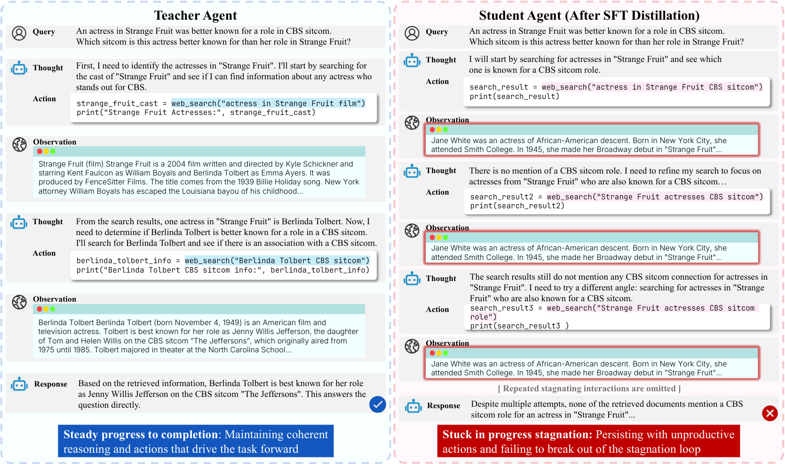
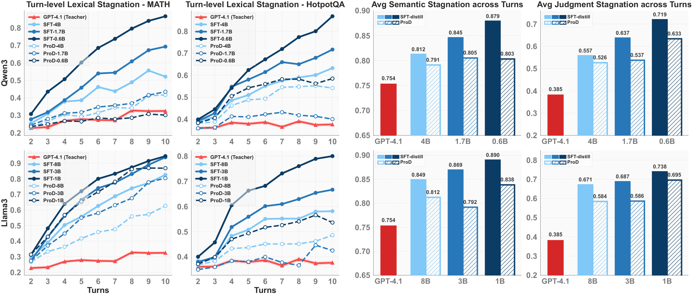

<h1 align="center">ProD: Progress-Aware Distillation</h1>

<p align="center">
  <a href="https://arxiv.org/abs/2610.19439"><b>Progress-Aware Distillation for Mitigating Stagnation in Small Language Model Agents</b></a>
  <br>
  NeurIPS 2026
</p>

<p align="center">
  <a href="https://caoyuanpu.github.io/">Yuanpu Cao</a><sup>1</sup>, Saket Sathe<sup>2</sup>, Hanyu Wang<sup>1</sup>, Ziyi Yin<sup>1</sup>, Fenglong Ma<sup>1</sup>, Jinghui Chen<sup>1</sup>
  <br>
  <sup>1</sup>The Pennsylvania State University &nbsp;&nbsp; <sup>2</sup>Microsoft CoreAI
</p>

<p align="center">
  
</p>

## Introduction

Small agents distilled from a strong teacher by SFT often *stagnate*: they repeat failed searches or code
across turns instead of making progress (above: a GPT-4.1 teacher vs. an SFT-distilled Qwen3-1.7B student).
ProD detects this in the student's own rollouts and penalizes it with an adaptive margin built from the
student–teacher stagnation gap and answer correctness:

```
L = -log σ( β/|τ| log p(τ|x) − β/|τ̃| log p(τ̃|x) − f(τ̃, τ) ) − λ/|τ| log p(τ|x)
f(τ̃, τ) = c0 · ( α · max(0, S(τ̃) − S(τ)) + (1 − α) · 1[Ans(τ̃) ≠ Ans(τ)] )
```

τ is a teacher (GPT-4.1) trajectory, τ̃ the SFT student's rollout on the same question, and S the
average turn-level stagnation (max ROUGE-L of each thought + action against all earlier turns).
Across Qwen3, Llama3 and Gemma3 students (0.6B–8B), ProD substantially reduces stagnation, moving the
students toward the teacher, while improving accuracy and cutting interaction turns (−11.6%) and tokens
(−20.7%) on average:

<p align="center">
  
</p>

## Setup

```bash
conda create -n prod python=3.12 -y && conda activate prod
pip install -e .            # installs the bundled smolagents fork and the `prod` package
pip install flash-attn --no-build-isolation
export OPENAI_API_KEY=...   # teacher rollouts and the GPT-4.1-mini answer judge
```

`src/smolagents` is a modified copy of [smolagents](https://github.com/huggingface/smolagents) (see
NOTICE); install into a fresh environment so it does not clash with an upstream smolagents.
HotpotQA / 2WikiMultiHopQA need the local Wikipedia retriever: see [retriever/README.md](retriever/README.md).

## Data

`data/` holds the question splits used in the paper:

| task | train | in-domain eval | out-of-domain eval |
|---|---|---|---|
| `math` | MATH, 3,010 | MATH val + test (770) | Omni-MATH L1–3 (500), L4–5 (500) |
| `hotpotqa` | HotpotQA, 3,000 | HotpotQA val (500) | 2WikiMultiHopQA (500) |

`data/release/` holds the GPT-4.1 teacher trajectories on both training sets (with judgments and
stagnation scores, plus the SFT set built from them) and the ProD pair data of the Qwen3-1.7B / 4B SFT
students used in the paper. Unpack them into `outputs/`:

```bash
bash scripts/unpack_data.sh
```

## Quick start

```bash
# 1. teacher trajectories + SFT set (skip if you unpacked the released data)
bash scripts/run_teacher.sh math

# 2. SFT -> student rollouts -> ProD pairs -> ProD -> evaluation, with the paper's settings
bash scripts/run_qwen3.sh math Qwen3-1.7B
```

`run_student.sh` reuses existing outputs: with the released pair data it goes straight from SFT to ProD
training. Accuracy and efficiency (avg turns / tokens) are printed by `prod.evaluate`. Agent rollouts
use vLLM with greedy decoding, which is not bit-reproducible across runs with LoRA.

### Step by step

Every step reads and writes `outputs/<task>/{trajectories,evaluations,stagnation,data,ckpt}/...`.

```bash
TASK=math; M=Qwen/Qwen3-1.7B
python -m prod.train_sft --task $TASK --model $M --output_dir outputs/$TASK/ckpt/sft_Qwen3-1.7B   # 5 epochs, keep epoch 3
SFT=outputs/$TASK/ckpt/sft_Qwen3-1.7B/checkpoint-261
python -m prod.rollout     --task $TASK --split train --model $M --lora $SFT --tag sft_Qwen3-1.7B
python -m prod.judge       --task $TASK --split train --tag sft_Qwen3-1.7B
python -m prod.stagnation  --task $TASK --split train --tag sft_Qwen3-1.7B
python -m prod.build_prod_data --task $TASK --student_tag sft_Qwen3-1.7B
python -m prod.train_prod  --task $TASK --model $M --init_lora $SFT --lr 5e-6 --c0 0.5 \
    --data outputs/$TASK/data/prod_sft_Qwen3-1.7B.json --output_dir outputs/$TASK/ckpt/prod_Qwen3-1.7B
python -m prod.rollout     --task $TASK --split val --model $M --lora outputs/$TASK/ckpt/prod_Qwen3-1.7B/checkpoint-346 --tag prod_Qwen3-1.7B
python -m prod.judge       --task $TASK --split val --tag prod_Qwen3-1.7B   # + test split / OOD sets
python -m prod.evaluate    --task $TASK --tag prod_Qwen3-1.7B
```

**Iterative ProD** (Sec. 4.4): roll out the ProD student on the training set, rebuild the pairs with
`--student_tag` set to it, and run `prod.train_prod` again with `--init_lora` pointing at it.

**Ablations** (Sec. 4.5): `--fixed_margin` gives *w/o AM*; `--fixed_margin --lambda_sft 0` gives
*w/o SFT + AM*; `--alpha 1` / `--alpha 0` use only the stagnation gap / only correctness (Table 6).
`prod.stagnation --metric semantic` computes the embedding-based score (`pip install -e .[semantic]`).

## Hyperparameters

LoRA rank 64 (α = 128, all linear layers), AdamW, linear schedule with 3% warm-up, bf16.

* **SFT**: lr 2e-4, 32 trajectories per step (2 × 16 accumulation), 5 epochs; the epoch-3 checkpoint is used.
* **ProD**: β = 2.5, λ = 1, α = 0.5, 16 pairs (32 trajectories) per step, a 2-epoch schedule; lr / c0 below.
  The checkpoint is chosen on in-domain evaluation. For the paper's Qwen3 students: MATH 4B epoch 1,
  MATH 1.7B epoch 2, HotpotQA 4B epoch 2, HotpotQA 1.7B epoch 1.

| ProD lr / c0 | Qwen3-4B | Qwen3-1.7B | Qwen3-0.6B | Llama-3.1-8B | Llama-3.2-3B | Llama-3.2-1B | Gemma-3-4B | Gemma-3-1B |
|---|---|---|---|---|---|---|---|---|
| MATH | 5e-6 / 0.5 | 5e-6 / 0.5 | 5e-6 / 0.5 | 5e-6 / 0.5 | 1e-6 / 0.5 | 1e-6 / 0.5 | 5e-6 / 0.7 | 1e-6 / 0.5 |
| HotpotQA | 1e-6 / 0.7 | 1e-5 / 0.5 | 1e-6 / 0.7 | 1e-6 / 0.5 | 5e-6 / 0.5 | 5e-6 / 0.5 | 5e-6 / 0.7 | 5e-6 / 0.3 |

For Gemma-3-1B we used `--attn_implementation eager` in ProD training on HotpotQA.

## Implementation notes

* Students are trained and evaluated with smolagents' compact `system_prompt_short`; teachers and base
  models use the full CodeAct prompt. As in the paper's runs, the training prompt lists only the
  `final_answer` tool for both tasks.
* For Qwen3, an empty `<think>\n\n</think>\n\n` block is inserted into every assistant turn of the
  training data, matching the inference-time prompt (`enable_thinking=False`).
* The loss covers assistant turns only (thoughts and code actions); observations are masked.

## Citation

```bibtex
@misc{cao2026progressawaredistillationmitigatingstagnation,
      title={Progress-Aware Distillation for Mitigating Stagnation in Small Language Model Agents}, 
      author={Yuanpu Cao and Saket Sathe and Hanyu Wang and Ziyi Yin and Fenglong Ma and Jinghui Chen},
      year={2026},
      eprint={2610.19439},
      archivePrefix={arXiv},
      primaryClass={cs.LG},
      url={https://arxiv.org/abs/2610.19439}, 
}
```

## Acknowledgements

Built on [smolagents](https://github.com/huggingface/smolagents),
[agent-distillation](https://github.com/Nardien/agent-distillation),
[Search-R1](https://github.com/PeterGriffinJin/Search-R1) and [TRL](https://github.com/huggingface/trl);
see NOTICE. Released under the Apache-2.0 license.
